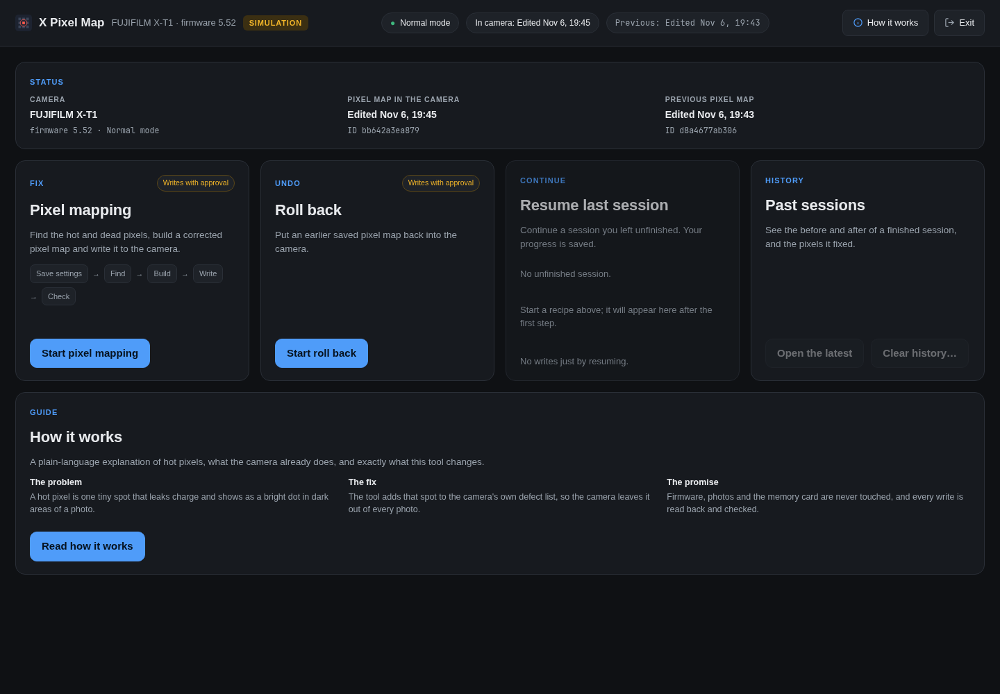
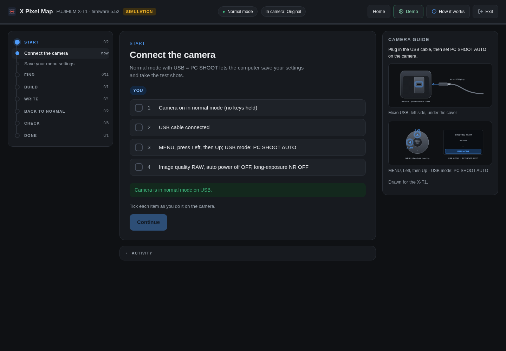
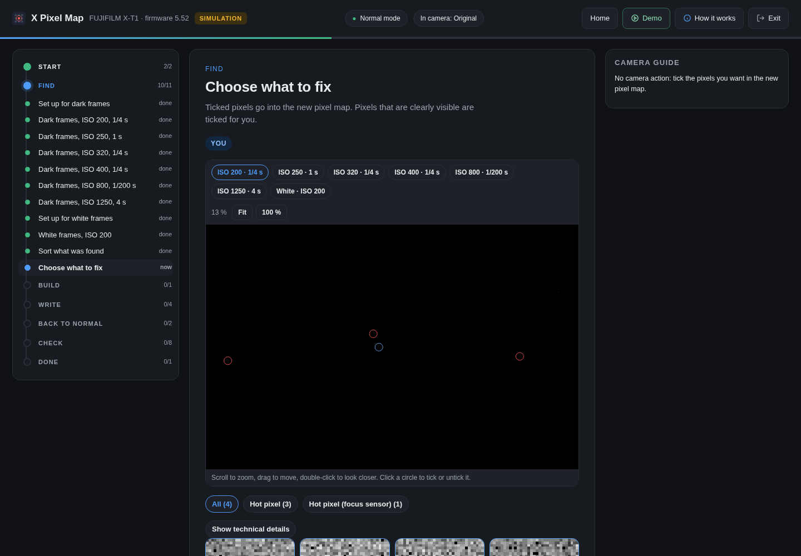
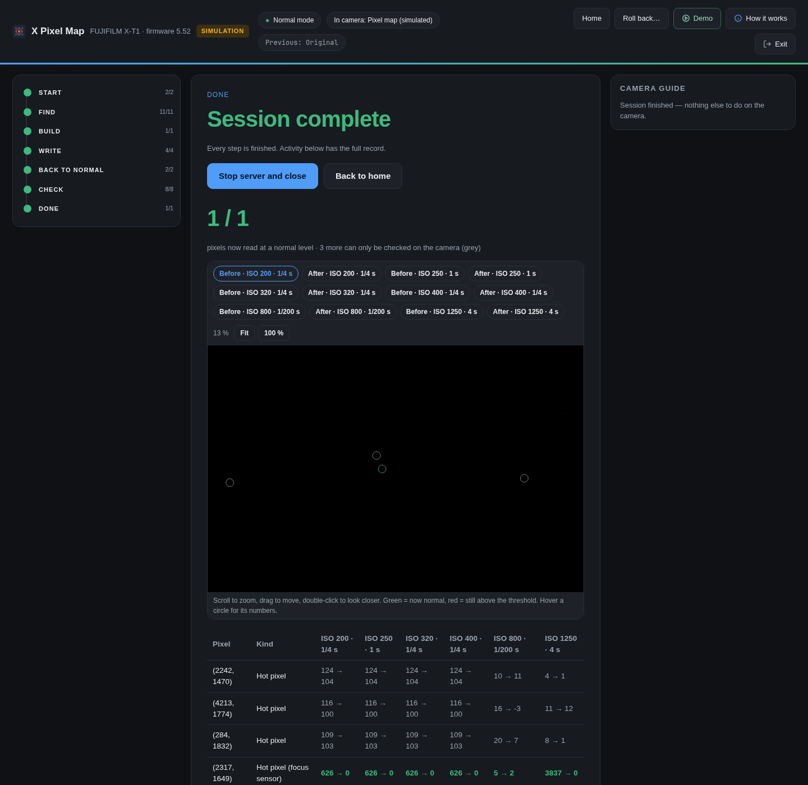
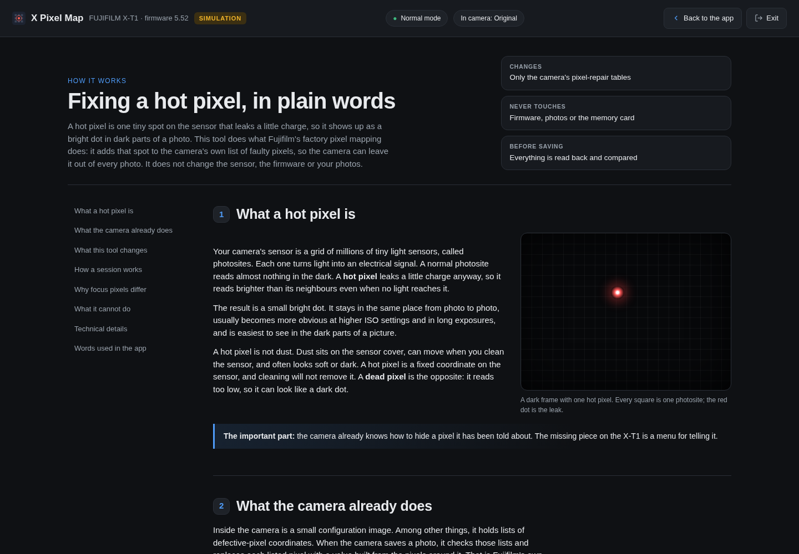

# X Pixel Map

> **Currently works only on the FUJIFILM X-T1 (firmware 5.52), and only on Linux.** More cameras (an X100T is next) and Windows
> and macOS support are planned, but none of them exist yet.

Fix hot pixels on a **FUJIFILM X-T1 (firmware 5.52)** at home, by editing the camera's own configuration image, which is
what Fuji's factory "pixel mapping" does. The X-T1 has no pixel-mapping menu (some later bodies do), and Fuji's answer is a
paid service visit.

> X Pixel Map is an independent project, not affiliated with or endorsed by FUJIFILM Corporation. FUJIFILM and X-T1 are
> trademarks of FUJIFILM Corporation.

## What it changes, and what it does not

It edits the camera's **pixel tables**: the lists of defective pixels (hot pixels and dead pixels) that the camera already
keeps in its configuration image, and, for a hot **focus (phase-detect) pixel**, the autofocus weight bytes that cover it. Every
other byte of the image is checked to be identical to the backup of your own camera before anything is written.

It does **not** touch Fujifilm's firmware or boot ROM, and it cannot: firmware upload and memory reads are not in the tool's
allow-list of USB commands. Your photos are never touched. The whole config image is written back, but every byte outside the pixel tables is the same as before.

It has been tested on one camera, an X-T1 on firmware 5.52, and works there when the instructions are followed exactly as written.
It makes a backup first, shows you the exact image and asks for approval, then reads the whole write back and compares it. Using it
is still your decision on your own camera, and without a warranty (see the license).

### Exactly what is modified

The camera's config image is 4,325,376 bytes (`0x420000`). The tool writes the whole image back, and these are the only places
it is allowed to differ from your own backup. The checker (`presave_checks` in `xpixelmap/image.py`) refuses to write if any
other byte differs.

| Where in the image | What it is | Changed? |
|---|---|---|
| Pixel lists `list0` (`0x76800`) and `list2` (`0x11c840`) | Fujifilm's own lists of defective pixels; hot and dead pixels are added here | **Yes**, entries are added for the pixels you tick |
| Count fields (`0x28e0` to `0x2904`) | How many entries each list holds | **Yes**, kept consistent with the lists |
| `0x113b6` to `0x113d1` (28 bytes) | Autofocus correction weight, one byte per ISO/exposure class | **Yes**, set to 0 in the new image unless already 0. One table covers every focus-grid pixel, so it is tiny but important |
| `0x2800` to `0x2804` (5 bytes) | Raw correction gate, one byte per ISO index | **Yes**, set to 127 (on at every shutter speed) when at the factory values |
| Lists `list1`, `list3`, `list4`, `list5` | Other lists in the same image | No; the guided recipe does not edit them |
| `0x80` to `0xa0` | Bytes the camera's own *save* command writes | Written by the camera when it saves, checked to be exactly what it leaves |
| `0x202`, `0x244`, `0xf7` | Image marker, list-reload flag, USB debug flag | No; checked to stay as they are |
| `0x3e0000` to `0x3fffff` | Lens profile data | No; checked identical |
| Everything else in the image | | No; checked identical, byte for byte |

The guided tool never edits `list1` or `list3`: focus-grid pixels are recognised and handled by the autofocus byte instead. The one
camera this was developed on does hold two earlier hand-made entries in those two lists, from research before the guided tool
existed; they are checked like everything else and the tool leaves them as they are.

Not in this image at all, so never written: the firmware, the boot ROM, your photos and your memory card. After writing, the
whole image is read back from the camera and compared with what was sent.

## Status: research project, one camera

Everything here was built and verified on a single X-T1 (firmware 5.52). It works there: ordinary hot pixels are added to the
camera's defect lists, and a hot **phase-detect (focus) pixel**, which the defect lists cannot fix, is cleared with one config
byte (cfg `0x113b6` = 0 for all 28 classes). The write path is tested with the camera's own firmware code in an emulator and
with fault injection (power cut at every block, corrupted transfers).

A hot focus pixel can also be fed by the ordinary pixel next to it. On the test camera, focus pixel (3208,1789) read normal on
the mechanical shutter once the pixel below it, (3208,1790), was added to the defect lists.

At ISO 1000 and below the factory leaves the camera's raw correction off at short shutter speeds, and hot pixels show through
there. The tool now switches it on at every speed (cfg `0x2800`..`0x2804` = 127). On the test camera this took the worst
pixel at ISO 800, 1/200 from +1787 to about 0 in dark frames. The correction still misses some pixels in single frames, so the
scan judges each frame on its own. It shoots 5 dark frames at six settings and lists a pixel that reads over +100 in every
frame, or over +200 in single frames at more than one setting. Listing 32 such pixels left none over +100 in 65 frames.

**Known limits in v1:**

- The raw correction change has been checked on dark frames only. Its effect on fine detail in real photos is not known yet.
- The six scan settings come from one full test of every ISO from 200 to 1600 on one camera. They caught 28 of the 32 pixels
  that test found, and the rule's numbers have not been tried on another X-T1.
- A pixel within 2 pixels of a listed one cannot be added, so a few can keep showing in single frames.
- At high ISO many pixels flare up for a moment, a different set each time. A list cannot catch these, so the app leaves them.
- Results come from one camera, in one set of test sessions. Most dark frames in the research notes used the electronic shutter,
  which is about 12-bit on this camera; the app now requires mechanical frames.
- The computer sets shutter speed and ISO with both dials on A. On a numbered ISO the camera ignores the computer.

It is **not yet a general tool**: the write guard is tuned to one unit and the tests need your own camera dump. Making it work
for other owners and bodies is open work (an X100T is next; same sensor).

## What is here

| Path | What it is |
|---|---|
| `xpixelmap/` | The safe write tool: read, back up, build an image, write it, read it back, compare. Five operations only, an allow-list of USB commands, and a journal for interrupted sessions. |
| `xpixelmap/ui/` | A local guided UI: Pixel mapping, Roll back, Resume, and a History of finished sessions. Timers, step-by-step instructions with drawings, a pixel review viewer, and one-press automatic setup. Opens in an app window (pywebview + GTK WebKit) or in the browser. Plain Python, HTML, CSS and JS; no build step. See `xpixelmap/ui/README.md`. |
| `tools/capture/` | Shooting and settings tools: dark and white frames over USB (gphoto2), hot-pixel detection, menu-settings and clock backup and restore. |
| `helper/` | The small shared modules the tools import (hot-pixel detection, defect-list encoding). |
| `PROCEDURE.md` | The full procedure start to finish, including how to enter and leave service mode safely. |

## Screenshots

From the built-in simulation, which replays saved frames with no camera connected.

**Home:** camera status, tasks, history and the plain-language guide.


**Step by step, with a drawing of the camera for each physical action:**


**Review what was found:** a zoomable view of the whole sensor, with a circle on each pixel and a plain-language reason for each. Ticked pixels go into the new pixel map.


**Before and after:** pixels re-checked from fresh frames after the write.


**How it works:** what a hot pixel is, what the tool changes and what it cannot do.


## Safety design

- The camera is written only after you press **Approve** on the exact image (its short hash), never by a keystroke.
- Every write is read back in full and compared byte for byte; the read-back is saved as a locked backup (and copied elsewhere).
- Nothing runs from `ff80 syslog`, firmware upload or RAM read; the tool cannot call them.
- An interrupted run comes back as "not done", never assumed finished.
- Closing the app window is refused while a step is running.

## Requirements (Linux for now)

- A FUJIFILM X-T1 on firmware 5.52, a USB cable, the shutter and ISO dials on A and the focus switch on M for captures.
- Python 3, `python-libusb1`, `gphoto2`, Pillow, numpy and unicorn. For the app window: `pywebview`, `python-gobject` and `webkit2gtk-4.1`.
- Windows and macOS are planned. The app window already runs on them; the camera USB layer is Linux-only for now, so the tool will not work there yet.

```bash
packaging/linux/install.sh                    # sets up .venv (uv if present, else python -m venv) and adds "X Pixel Map" to your applications menu
packaging/linux/install.sh --uninstall        # removes the launcher and icon again
```

Or run it by hand:

```bash
uv venv --python /usr/bin/python3 --system-site-packages .venv
uv pip install --python .venv/bin/python numpy pywebview
.venv/bin/python -m xpixelmap.ui              # guided UI
.venv/bin/python -m xpixelmap.ui --browser    # no app window; open the printed address
```

After installing, search for **X Pixel Map** in your launcher; it opens as its own window with its own icon, no terminal needed.

The app is its own window: the local server runs only while the window is open, and closing the window asks first (and is refused
while a step is running), so there is no background service and no tray icon.

## Your own files

The tool never ships anyone's camera data. The first run reads your camera once in service mode and keeps that as your backup. It expects:

- `camera/cfgdata_dump_BACKUP_original.bin` (for the tests only): your own untouched config dump, read once with
  `python -m xpixelmap backup --real` (or point `XPIXELMAP_FACTORY_BACKUP` at it).
- `XPIXELMAP_SAFE_COPY` (optional): a folder on another disk where backups and captures are copied as well.
- The tests under `xpixelmap/tests` need that dump and skip with a message without it. The demo (`--simulate`) needs recorded
  fixtures that are not included, so it exits with an explanation; the screenshots above come from the author's own recording.
- The write guard is tuned to the author's unit (list sizes). On another camera it may stop a save; it stops safely. Please
  open an issue with what it printed.

## What is not here

No Fujifilm firmware, config dumps, captures, backups, decompiler output or research notes (open an issue if you want the notes). Those files are Fujifilm's or are private to one camera,
so they are not redistributed here. Scanning needs none of them. Before a save, the tool rehearses the write in an emulated camera,
and that needs Fujifilm's firmware file: update your X-T1 to 5.52, download the same [firmware from Fujifilm](https://fujifilm-x.com/global/support/download/firmware/cameras/x-t1/)
and choose `FWUP0005.DAT` on the home screen, once. The file is checked by its hash and stays on your computer. Bundled third-party code: `tools/fffw/ff80`
from [fffw](https://github.com/tiredboffin/fffw), with its licence. Related project: [FujiMod](https://fujimod.com).

## License

MIT, see `LICENSE`.
